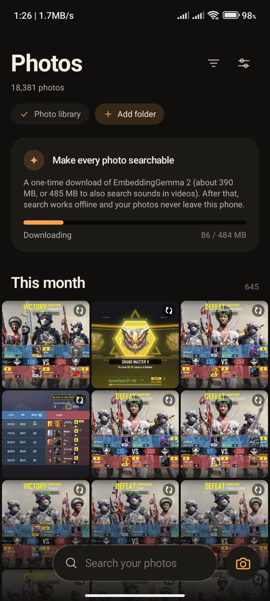
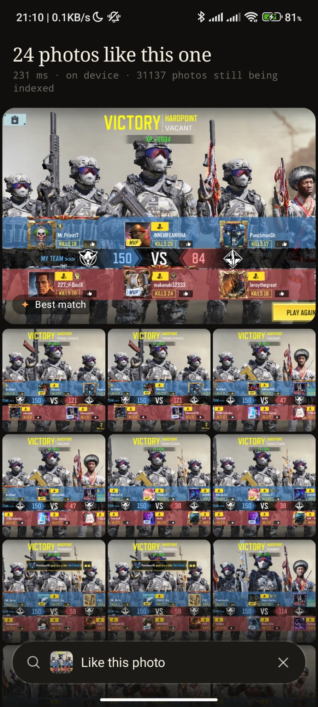
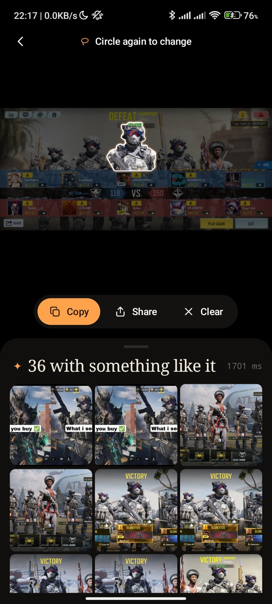
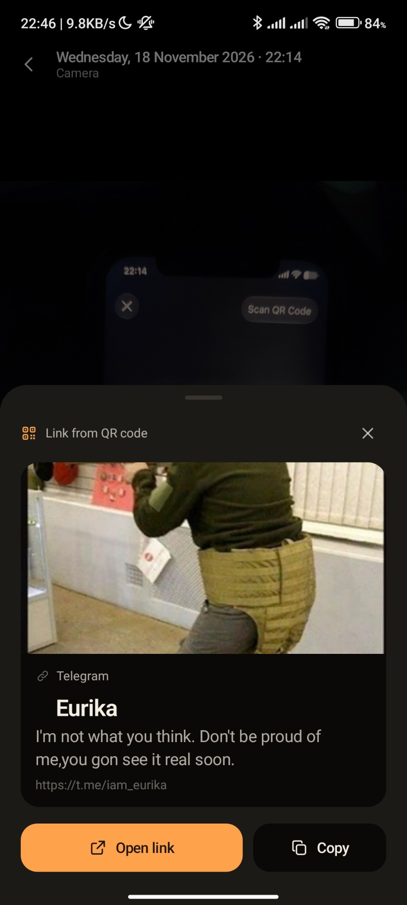

# SeekFrame

An Android photo and video gallery with on-device AI search. Type what you remember ("dog on the beach",
"receipt from the hardware store"), jump to the moment in a video where it was seen or heard,
circle something in a photo to find more like it, read QR
codes, and copy text straight out of pictures. **Nothing leaves the phone**: every model runs
locally, and the network is used only to download the search model once (and to preview a QR
link when you tap it).

**No internet required: it works utterly offline.** Once the model is on the phone (or straight
away if Android's own copy is used), you can switch on airplane mode and everything still works:
browsing, indexing, text search, similar photos, circle to search, QR detection and copying
text. The only thing that ever needs a connection is the optional link preview when you tap a QR
code.

> **Work in progress:** video indexing isn't working yet. Videos browse and play normally, but
> searching inside them (what's seen or heard) is still being worked on.

- Package: `com.lucrativeworm.seekframe`
- Kotlin + Jetpack Compose, minSdk 29, target/compile SDK 37, AGP 9.5
- ABIs: `arm64-v8a`, `x86_64`

## How it works

<table>
  <tr>
    <td width="220"></td>
    <td>
      <b>1. Get the search model once.</b><br>
      The library opens straight away, grouped by month. A card offers a one-time download of
      EmbeddingGemma 2 (about 390 MB, or 485 MB with sound search). If the phone has Android's
      own copy, nothing is downloaded. From then on everything runs offline, and the app starts
      indexing photos newest first. The circular badge on each tile shows it's still queued.
    </td>
  </tr>
  <tr>
    <td></td>
    <td>
      <b>2. Find photos like this one.</b><br>
      Choose <i>Similar</i> on any photo (from the viewer, a long-press peek or search results).
      Its vector is compared against the on-device index, and the closest matches come back,
      best match first. The header shows how long that took (here 231 ms) and how many photos
      are still being indexed. Results get better as indexing catches up.
    </td>
  </tr>
  <tr>
    <td></td>
    <td>
      <b>3. Circle to search.</b><br>
      Draw a loop, scribble or tap over anything in a photo. MagicTouch lifts that object out
      and dims the rest, and only the cutout is searched, so the results are photos with
      <i>something like it</i> rather than photos like the whole picture. Circle again to change
      the selection, or <i>Copy</i> / <i>Share</i> the cutout as a transparent sticker.
    </td>
  </tr>
  <tr>
    <td></td>
    <td>
      <b>4. Open QR codes found in photos.</b><br>
      QR codes are detected offline and bracketed in the viewer. Tap one to get a sheet with
      the link's title, description and image. This preview is the only thing fetched from the
      internet, and only when you tap. Then <i>Open link</i> or <i>Copy</i> it.
    </td>
  </tr>
</table>

Text works the same way: long-press words in a photo to select them, then copy.

---

## Features

### Browsing
- **Library grid** grouped by month, with each photo's average colour as an instant placeholder
  while its thumbnail decodes.
- **Pinch to resize** the grid (2–5 columns); it "gives" under the fingers and snaps with a
  haptic tick at each step.
- **Period scrubber**: a fast-scroll handle on the right edge that labels years while dragging.
- **Peek**: long-press a photo to lift it over a blurred library, iOS-style, with Open, Similar,
  Select, Share and Delete.
- **Multi-select** with select all, share and delete (with a confirm sheet for anything
  irreversible).
- **Viewer** with a shared-element transition from the grid, zoom/pan, swipe between photos,
  drag to dismiss, and system bars hidden while the photo is shown alone.
- **Photo details**: slide a photo up for date, camera, lens, exposure, size and location
  (read from EXIF; GPS needs `ACCESS_MEDIA_LOCATION`).
- **Filter** the library to photos, videos or both, newest or oldest first.

### Videos
> Video indexing isn't working yet; the two search features below are still in progress.

- Videos sit in the grid with their duration, using a frame as the thumbnail (Coil video).
- The viewer plays them with Media3 ExoPlayer: one shared player for the current page, poster
  frames for the others so swiping stays cheap.
- **Search inside videos**: frames are embedded into the same space as photos, so a text search
  can land on a video *at the moment* that matched. The scrubber shows a tick at every matching
  moment, and tapping near one snaps to it.
- **Search what's heard** (opt-in): with the audio-capable model, the soundtrack is embedded too,
  so "dog barking" or "applause" finds the moment it was heard. Asked once before the first
  model download, since the answer decides which model file to fetch; changeable in Settings.

### AI search
- **Text search** across the whole library with **EmbeddingGemma 2** (text + vision, 440M).
  Text and images share one vector space, so a single nearest-neighbour index answers typed
  queries and "more like this photo".
- **Similar photos** from any photo (viewer, peek or search results).
- **Circle to search**: draw a loop, scribble or tap over anything in a photo. MediaPipe's
  **MagicTouch** interactive segmenter lifts that object out, the rest dims, and the cutout is
  embedded to find photos containing something like it. Or search with the whole picture.
- **Stickers**: a lifted object can be copied to the clipboard or shared as a transparent PNG.
- **Snap**: take a photo with the system camera and circle-search with it.
- Results use a similarity band relative to the best match rather than a fixed cut-off, since
  cross-modal scores are low in absolute terms.

### Photos as information
- **QR codes** are found in photos with ML Kit's bundled (offline) barcode model, bracketed in
  the viewer, and labelled with their host. Tapping one opens a sheet with a link preview
  (title, description, Open Graph image) fetched only on tap, capped at 256 KB, never executing
  anything from the page.
- **Text selection**: long-press text in a photo to select words (ML Kit's offline Latin text
  recognizer) and copy them, with highlights that stay glued to the text while zooming.

### Photo sources
- **Media library** (MediaStore), including Android 14's "selected photos" partial access.
  Additions, edits and deletions are mirrored automatically.
- **Picked folders** via the system folder picker (Storage Access Framework) to reach images the
  media library never sees: `.nomedia` folders, synced cloud folders, other apps' exports.
  Grants persist across reboots; folders appear as chips and are removed with a deliberate
  two-tap confirm. Overlapping copies of media-library files are de-duplicated.

### Indexing
- Photos are embedded newest first (so what you just shot is searchable first), from a small
  thumbnail at a 70-token vision budget, and stored in ObjectBox's HNSW vector index.
- **Asked once before the first pass**: index now, or only while charging and idle (overnight).
  Changeable in Settings.
- **Keeps the phone usable**: steps aside while you touch the app, runs at about half duty with
  the screen on, faster with it off, flat out on charge, and backs off or stops when the phone
  heats up. Searches never wait behind more than one image.
- **Background work** via WorkManager: a visible, cancellable foreground job (with a Pause
  action on its notification), a content-URI trigger so new photos become searchable without
  opening the app, and a catch-up pass while charging. The worker drives the same in-process
  indexer as the UI, so there is never a second model in memory.
- A user pause sticks until the user resumes.

### Backup and restore
Indexing a big library takes a while, so you only have to do it once. **Settings → Backup**
saves the search index to a folder you pick, and restores it after a reinstall or on a new phone.
- **Set it up once**: choose a folder, such as `Documents/SeekFrame` (or a synced cloud folder
  to keep a copy off the phone). Then tap **Back up now**.
- **Automatic backups** (on by default): after indexing finishes, a fresh dated backup is
  written, but only if the index has changed. The newest 5 are kept and older ones are removed.
- **Restore in one tap**: the backups in the folder are listed with their date, how many photos
  and videos they cover, and their size. Tap **Restore** on one. After a reinstall, choose the
  same folder again and your backups appear.
- **Matched by file, not by database id**: each entry carries the photo's path and modification
  time, so vectors land on the right photos on another phone or after a reinstall. Photos the
  backup doesn't cover (new, edited, or not on this phone) are simply indexed as usual, and
  photos already indexed are left alone.
- A backup holds only the vectors, never the photos themselves. It is a small gzip file
  (`.aigi`) that stays wherever you put it; nothing is uploaded. Vectors are tied to the model
  that made them, so a backup from a different model is shown but can't be restored.

### Model choice (Settings)
EmbeddingGemma 2 can come from two places:
- **Android's own copy** through ML Kit GenAI on AICore: no app download, updated by the
  system, NPU-accelerated where available. Only on supported phones.
- **Bundled LiteRT-LM file** (~390 MB, Apache 2.0, from Hugging Face
  `litert-community/embeddinggemma-2-text-vision-440m-litert-lm`), run through MediaPipe's
  UniversalEmbedder. Works on any phone. Two variants: text + vision (~390 MB) by default, or
  text + vision + audio (~485 MB) when sound search is on. Android's copy has no audio encoder,
  so sound search always uses the bundled file.

The default (**Auto**) uses Android's model when available, otherwise the bundled one. Vectors
are tagged with the model that made them; switching models re-queues only the photos the new
model hasn't indexed, since the two vector spaces can't be compared.

**AICore's limits don't hold the app back.** Google notes that AICore needs Android 14 or
higher, that its features vary by device and manufacturer, and that it can temporarily use extra
storage during background updates. None of that is a requirement here: AICore is only an
optional source of embeddings. The search index itself lives in the app's own ObjectBox
database, and the bundled LiteRT-LM model runs on any supported phone from Android 10
(minSdk 29) upward. If AICore is missing, unsupported or busy updating, Auto simply uses the
bundled model, and search, similar photos and circle to search work the same.

### Design
- **"Darkroom"** theme: warm ink-and-paper chrome so photos are the only saturated thing on
  screen, with one safelight-amber accent reserved for AI moments (search, indexing).
- **No Material dependency**: the UI is built on Compose Foundation with the app's own design
  tokens, a hand-drawn icon set (24-unit grid, round caps), and spring-based motion so every
  gesture can be interrupted. Ambient motion stops when the system's animations are turned off.
- A first-run welcome screen where a stack of "prints" deals itself onto the table, promising
  that nothing leaves the phone.

---

## Architecture

```
app/src/main/java/com/lucrativeworm/seekframe/
├── GalleryApp.kt          Application + hand-rolled dependency graph (no DI framework)
├── MainActivity.kt        Root composable, permissions, back stack (Viewing / Circling / Configuring)
├── data/
│   ├── Entities.kt        ObjectBox entities: Photo (photos + videos), Folder, and the two
│   │                      HNSW-indexed vector boxes PhotoVector and VideoMoment (frame/sound spans)
│   ├── Db.kt              BoxStore setup, Query → Flow helper
│   ├── MediaLibrary.kt    MediaStore → ObjectBox mirror and change observer
│   ├── FolderLibrary.kt   SAF folder sources, sync, de-dupe, delete
│   ├── IndexBackup.kt     Search index ⇄ portable .aigi file, matched to photos by path
│   ├── IndexBackups.kt    Backup folder, dated backups (newest 5 kept), auto backup, restore
│   ├── PhotoDetails.kt    EXIF / metadata loader for the details panel
│   └── LinkPreview.kt     On-tap link preview for QR codes
├── ml/
│   ├── ModelStore.kt      Picks/downloads EmbeddingGemma 2 (system or bundled vision/audio
│   │                      variant, resumable) and holds the sound-search choice
│   ├── SystemModel.kt     ML Kit GenAI Embeddings on AICore
│   ├── Embedder.kt        Thread-safe, fair-mutex wrapper over either model
│   ├── Indexer.kt         Pending-item pass with thermal/interaction throttling
│   ├── VideoIndexer.kt    Video → VideoMoments: changed frames and non-silent sound, resumable
│   ├── SearchEngine.kt    Text, similar-photo and image queries over photos and video moments
│   ├── Images.kt          Bounded ARGB_8888 decode shared by the ML pipelines
│   ├── Segmenter.kt       MagicTouch interactive segmenter
│   ├── Lift.kt            Gesture classification, cutout, hole filling, query framing
│   ├── Stickers.kt        Copy/share cutouts as transparent PNGs via FileProvider
│   ├── QrScanner.kt       Offline QR detection, cached per photo
│   └── TextScanner.kt     Offline text recognition, words in reading order
├── work/
│   └── IndexWorker.kt     WorkManager worker, IndexScheduler triggers, PauseReceiver
└── ui/
    ├── GalleryViewModel.kt, CircleViewModel.kt
    ├── screens/           Welcome, Gallery, Viewer, CircleSearch, Settings
    ├── components/        Peek, Selection, PeriodScrubber, PhotoInfo, QrViews, TextSelect,
    │                      VideoViews, FilterSheet, SoundsSheet, Sources, IndexScheduleSheet,
    │                      Primitives, Glyphs, Shared
    └── theme/Theme.kt     Palette, type and motion tokens
```

### Key libraries
| Purpose | Library |
|---|---|
| UI | Jetpack Compose (Foundation, Animation), Coil 3 (+ coil-video for frames) |
| Video playback | Media3 ExoPlayer |
| Storage / vector search | ObjectBox 6 (HNSW) via kapt |
| Embeddings | ML Kit GenAI Embedding, MediaPipe Tasks Retrieval, LiteRT-LM |
| Segmentation | MediaPipe Tasks Vision (Interactive Segmenter) |
| QR / text | ML Kit Barcode Scanning, ML Kit Text Recognition (bundled) |
| Background | WorkManager |

---

## Building

Open the project in Android Studio and run the `app` configuration, or:

```bash
./gradlew :app:assembleDebug
```

- The **MagicTouch segmentation model** (~30 MB) is downloaded at build time by the
  `downloadSegmenterModel` task into `app/src/main/assets/interactive_segmentation.task` and
  verified by SHA-256. If Google publishes a new "latest" model the build fails with a checksum
  mismatch; verify the new file and update the expected hash in `app/build.gradle.kts`.
- The **EmbeddingGemma 2** model is not in the APK. The app offers it as a one-time download
  ("teach the gallery to see"), or uses Android's copy. To skip the download during
  development, push the file to the device:

```bash
adb push embeddinggemma-2-text-vision-440m.litertlm /data/local/tmp/aigallery/
```

- Model files (`.litertlm`, `.tflite`, `.task`) are stored uncompressed in the APK.
- On emulators the LiteRT GPU path is avoided because the software "GPU" is slower than
  XNNPack on CPU.

## Permissions

| Permission | Why |
|---|---|
| `READ_MEDIA_IMAGES`, `READ_MEDIA_VISUAL_USER_SELECTED` (`READ_EXTERNAL_STORAGE` ≤ API 32) | Read the photo library (full or selected) |
| `ACCESS_MEDIA_LOCATION` | Show where a photo was taken in its details |
| `INTERNET` | Download the model once; QR link previews on tap |
| `POST_NOTIFICATIONS`, `FOREGROUND_SERVICE`, `…_DATA_SYNC`, `…_MEDIA_PROCESSING` | Visible, cancellable background indexing |

---

## Shelved: in-app live camera

`shelved/CameraScreen.kt` is a CameraX viewfinder that brackets QR codes live and snaps photos
for circle search. It was pulled from the build on 2026-11-18 and Snap uses the system camera
again. See [shelved/README.md](shelved/README.md) for how to bring it back.

---

## License

Copyright 2026 Eurika

Licensed under the [Apache License, Version 2.0](LICENSE). See [NOTICE](NOTICE) for
attribution.
